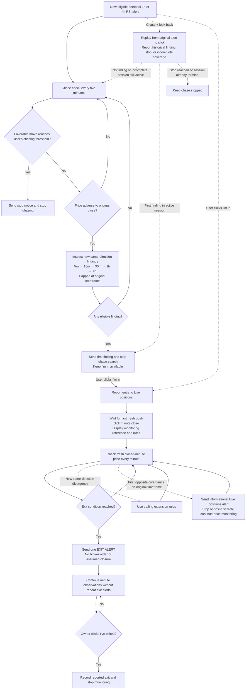

# Chasing and alert-only position flow

The user's favorable chasing threshold defaults to 0.5% and uses the original signal
close. It is separate from position exits, whose percentages use a displayed market
reference until a trading platform supplies actual fills.

Without another divergence: initial loss/profit alerts are ±0.5% for 1h originals and
±1% for 4h. With an additional same-direction divergence: activate a 0.5% trail at +1%;
for 4h, widen to 1% at +2%. The active trail replaces the original loss stop. A chase
finding already known when entry is reported qualifies; a third finding is unnecessary.

Done/Undo dismisses messages; I've exited reports that the position is no longer held.
Data failures suspend exit evaluation and generate a warning, followed by a recovery
notice when fresh data resumes. The check cadence is nominal and provider-dependent.
See [the full operational specification](telegram-position-monitor.md).

Earlier annual comparison results remain pinned to their recorded implementation and
minute chase-check cadence. This updated flow is not a claim of a deployed worker.

The [lookback specification](chase-lookback.md) defines retrospective results and terminal-state preservation. The return to live chasing applies only while the original session remains active.
