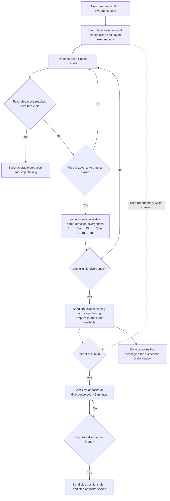

# First-divergence chasing flow

The favorable-stop setting is a positive percentage, default **0.5%**: upward for
bullish signals and downward for bearish signals, anchored to the original close.
Settings changes apply to new sessions. The threshold stops monitoring; it does not
place or close an order.

The smallest eligible timeframe wins within a minute. The first finding stops the
search regardless of its timeframe; there is no required ladder of confirmations.
Signals already known at the previous check do not become new when price turns adverse.
A return to the original close after adverse movement can send a non-terminal notice,
at most once per rolling minute per user. Neither Done nor an alert reports a trade fill.

The backtest runs separately: every original is retained, and observational follow-ups
found after a strategy stop are labeled separately from strategy-eligible alerts.
