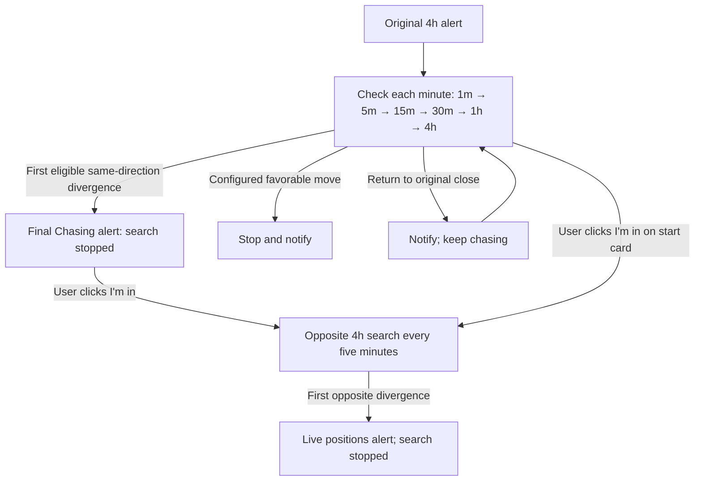

# First-divergence chase implementation

Implemented locally on the planning branch. Not deployed, enabled or provisioned in
production; no real Telegram messages or orders were sent during implementation.

## Current behavior

After delivery of a new provisional 4h personal RSI alert, an opted-in registered user
gets a separate chase session and a Chasing start card. Once per minute, while the fresh
closed-minute price is adverse to the original close, inspect new same-direction
divergences in **1m → 5m → 15m → 30m → 1h → 4h** order. The first qualifying finding
at **any** timeframe produces the final chase alert and stops searching. The earlier
descending ladder is superseded. Within one frame, select its earliest newly available
event; old findings are not replayed when price later turns adverse.

Only the enrolled user's I'm in click confirms reported entry. It remains usable on
the final first-divergence card. Entry switches that session to opposite **4h** divergence
monitoring, checked every five minutes. The first opposite finding creates a Live
positions alert and stops that search. No broker or paper-trading path is called.

Independently, a fresh minute close reaching the user's favorable threshold from the
original 4h close stops chasing and produces a stop alert. Default 0.5%; configure under
Settings → Chasing. Settings are private per user, versioned, persisted, and copied into
new sessions; saves do not change already running sessions. Bullish/up and bearish/down
use the same positive magnitude. At the exact threshold the stop is inclusive.

After an adverse price returns to the original close, send a non-terminal return notice.
Its rolling 60-second reservation is shared across that user's chase sessions. Notification
preferences suppress messages without implying entry or trade closure. Favorable-stop
and first-divergence events are terminal; pending ordinary chase notices become stale.

Done uses the existing message-only three-second deletion/Undo behavior. Undo restores
the I'm in button as well as the original content. A pending/deleted message cannot
confirm entry. No Close the deal action is offered because execution is not connected.

## Code and storage

- `divergence_chasing.py`: pure, deterministic state machine; timestamps in UTC ms.
- `chasing_runtime.py`: enrollment, owned polling, row-locked transitions, outbox,
  recipient/message-bound callbacks, reservation-based delivery and delayed retry.
- `cloud/divergence-chasing.sql`: additive private state, per-user preferences, scoped
  settings API and owner-only chat registration. Both new notification choices default off.
- `web/app.js`: personal Settings controls, session status and owner registration of
  the manually verified personal group IDs. Existing 13 category preferences are preserved.
- Existing single Telegram listener handles the new callbacks; no second poller exists.
  Runtime uses the existing owner/effects guard and bounded shared DB pool.

Initial live provider support is **Kraken spot only**, using the exact root venue/pair.
There is no fallback to another venue/instrument. Other roots remain unavailable until
an exact minute feed is implemented and tested. Source adapters expose the four extra
intraday Kraken intervals to this worker; ordinary scanner timeframes remain unchanged.
The current worker is synchronous and batch-fetches the six intervals per due feed/rules
snapshot. Provider delays/rate limits can delay nominal check times; a strict minute SLA
under many feeds needs further request scheduling/load validation before broad activation.
No maximum live chase duration has been imposed; research horizons are separate.

Delivery remains at-least-once after ambiguous Telegram timeouts, as with existing
delivery. A permanent API failure delays that event while other recipients continue.
State transitions commit with their outbox events; delivery retries do not restart search.

## Deployment prerequisites (not performed)

The initial rollout is restricted to the installation owner from the existing database
record. Server-side settings, registration, enrollment, polling, callbacks and recipient
selection enforce this scope; another member cannot opt in. Both notification choices
and the runtime flag remain off until real personal chats have been verified.

1. Review this implementation and apply `cloud/divergence-chasing.sql` after the current
   personal Telegram migration, first in a disposable environment. It creates no chats.
2. Each person manually creates Chasing and Live positions groups containing only them
   and the bot. Verify identities/membership privately. Use the owner-only registration
   controls to save two distinct destinations per user. Do not start another update poller.
3. Deploy source through the existing production service and dashboard process described
   in `POSTGRES_MIGRATION.md`; keep the existing worker as sole owner. Set
   `DIVERGENCE_CHASING_ENABLED=true` only for a reviewed activation. Default is false.
   Each recipient must also enable their personal preferences. No demo alert is implied.
4. Preserve original routes, message history and existing effects/dry-run gates. Do not
   enable legacy executable publication. Any future push requires exact-SHA checks and
   any actual deployment requires safe health/version verification per `AGENTS.md`.

The registration UI requires an already enrolled Telegram recipient and verified dashboard
membership; it does not perform Telegram membership verification itself. That remains a
manual prerequisite, explicitly stated beside the controls. It rejects shared/reused routes.

## Offline replay

`chasing_research.py` accepts explicit file arguments `--4h`, `--1h`, `--30m`, `--15m`,
`--5m`, `--1m`, `--symbol`, `--as-of` and a new `--output` directory. Optional parameters:
`--stop-pct` (default .5), `--cost-bps` (default 10, hypothetical total roundtrip cost),
`--horizon` (default three original 4h bars). It never loads credentials, contacts a
provider, starts a scanner or connects to a database. Runtime Python dependencies must
be installed because the existing shared detector imports Postgres types.

It preserves volume, hashes raw files, validates OHLC/timestamps/duplicates, excludes
unfinished/future bars, and splits detector history at absent scheduled candles. Detection
reuses repository RSI(3), BB and provisional-close rules; exported indicator columns are
ignored. Volume features include raw signal-candle volume and RVOL against the preceding
20 same-frame candles. Outcomes compare original and first-chase entry, strictly after
availability, through a common origin horizon with configurable cost. A final-1m subgroup
is diagnostic only; it is not a requirement for the first-chase policy.

Reports include root/event ledgers, all-root counts, no-entry/incomplete counts, pairwise
MAE comparisons, volume observations and conditional net return summaries. Missing price
paths never become fabricated wins or zero-drawdown trades. The tool does not yet fit
predictive volume models or optimize filters. The repaired sample now has complete paths,
but only six original roots and two chase entries, which do not support fitting or
validating those models. Opposite-alert exits,
portfolio sizing and holdout inference remain research extensions, not claimed results.

## Initial NEAR/USD audit (superseded by repair)

The original audit counted 1,763 absent 1m intervals, ten 5m intervals, two 15m intervals
and one 30m interval. It could not establish why those rows were absent and therefore
excluded incomplete outcome paths. Those initial outputs remain in
`data/chasing-near-validated/` for comparison, not as the current completed result.
The earlier `data/chasing-near-first/` run used the superseded ladder and must not be
used as the current strategy result.

## Gap repair update

The minute-interval blocker is now resolved using verified Kraken no-trade history and
the user-approved labeled empty-observation policy. See [repair procedure and results](kraken-minute-repair.md).
All six original outcomes and both chase entries have complete paths in
`data/chasing-near-complete-comparison/`. No fills occur on empty observations. Four
provider/export overlap conflicts remain recorded, with original values preserved.
The initial strict-gap audit above is historical; this update supersedes its data blocker.
